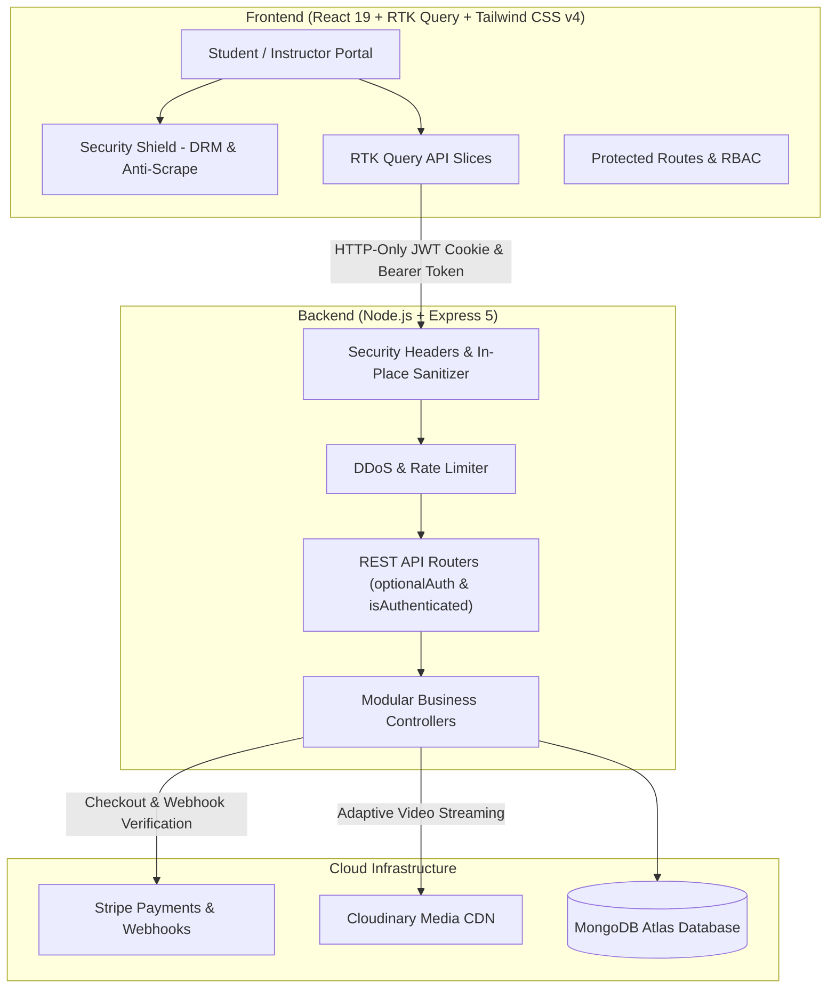

# 🎓 SkillStack LMS — Enterprise Full-Stack Learning Management System

[](https://github.com/SandeepCodes31/SkillStack/stargazers)
[](https://opensource.org/licenses/ISC)
[](https://react.dev/)
[](https://nodejs.org/)
[](https://expressjs.com/)
[](https://www.mongodb.com/)
[](https://tailwindcss.com/)
[](https://stripe.com/)
[](https://cloudinary.com/)
[](#-automated-testing--quality-assurance)

> **SkillStack LMS** is an enterprise-grade, production-ready Learning Management System engineered from scratch for scalable digital education. The platform features dual role-based workflows (Student, Instructor, and Admin), Cloudinary-powered adaptive video streaming, automated course progression tracking, assessment quizzes with auto-grading, cryptographically verifiable PDF certificates with scannable QR codes, gamified daily learning streaks, Stripe Checkout with idempotent HMAC webhook verification, a comprehensive security suite, and 41 automated regression and end-to-end integration tests.

Designed and developed from scratch by **[Sandeep Pal](https://github.com/SandeepCodes31/)**.

- 🌐 **Project Repository**: [https://github.com/SandeepCodes31/SkillStack.git](https://github.com/SandeepCodes31/SkillStack.git)
- 👤 **Author's GitHub Profile**: [https://github.com/SandeepCodes31/](https://github.com/SandeepCodes31/)

---

## 📑 Table of Contents

- [✨ Comprehensive Feature Breakdown](#-comprehensive-feature-breakdown)
  - [👨‍🎓 Student Experience & Learning Journey](#-student-experience--learning-journey)
  - [👨‍🏫 Instructor & Admin Operations](#-instructor--admin-operations)
  - [🛡️ Enterprise Security Suite & DRM Protection](#️-enterprise-security-suite--drm-protection)
- [📚 Realistic Sample Course Catalog](#-realistic-sample-course-catalog)
- [🧪 Automated Testing & Quality Assurance](#-automated-testing--quality-assurance)
- [🛠️ Deep-Dive Tech Stack Architecture](#️-deep-dive-tech-stack-architecture)
  - [1. Authentication, RBAC & Token Invalidation (`tokenVersion`)](#1-authentication-rbac--token-invalidation-tokenversion)
  - [2. Payment Gateway Architecture (Stripe & Webhooks)](#2-payment-gateway-architecture-stripe--webhooks)
  - [3. Database Modeling (MongoDB & Mongoose 9)](#3-database-modeling-mongodb--mongoose-9)
  - [4. Media & Video Streaming Pipeline (Cloudinary & Multer)](#4-media--video-streaming-pipeline-cloudinary--multer)
  - [5. Document Generation Engine (PDFKit & QRCode)](#5-document-generation-engine-pdfkit--qrcode)
  - [6. Frontend State Management (Redux Toolkit & RTK Query)](#6-frontend-state-management-redux-toolkit--rtk-query)
  - [7. UI System & Design Tokens](#7-ui-system--design-tokens)
- [🏗️ System Architecture & Workflow](#️-system-architecture--workflow)
- [📂 Complete Project Directory Structure](#-complete-project-directory-structure)
- [⚙️ Environment Variables Reference](#️-environment-variables-reference)
- [🚀 Quick Start & Installation Guide](#-quick-start--installation-guide)
- [📡 Complete REST API Reference](#-complete-rest-api-reference)
- [👨‍💻 Author & Attribution](#-author--attribution)
- [📄 License](#-license)

---

## ✨ Comprehensive Feature Breakdown

### 👨‍🎓 Student Experience & Learning Journey

1. **Context-Aware Adaptive Hero Section**:
   - **Guest / Unauthenticated View**: Automatically hides personalized progress counters to prevent artificial mock data. Displays an interactive tech stack badge showcase (React, Python, Node, AI/ML, Cloud Architecture), student collaboration visuals, platform statistics, and quick-start actions.
   - **Authenticated View**: Dynamically pulls the student's live enrolled course, real completion percentage bar, module counters, live fire streak (`🔥`), and verified credentials count with direct "Resume Lesson" navigation.
2. **Open Course Discovery & Intelligent Multi-Filter Search**:
   - Fully open course searching via `optionalAuth`, allowing unauthenticated guest visitors to browse, search, and filter courses without 401 barriers.
   - Real-time multi-criteria filtering by category (Web Development, Programming & Software Development, AI & Machine Learning, Data Science, Cloud & DevOps, UI/UX Design), difficulty level (Beginner, Intermediate, Advanced), and price sorting.
   - Homepage Featured Courses section strictly displays the **6 latest published courses** sorted by newest first, automatically cycling older courses into the full searchable catalog.
3. **Interactive Course Detail & Syllabus Preview**:
   - Dark glassmorphic hero header showcasing course level, student enrollment count, star ratings, and instructor credentials.
   - *"What You'll Learn & Build"* structured learning outcomes, prerequisites, and target audience.
   - Interactive lecture syllabus with duration badges, locked indicators, and instant free video previews. Non-free preview video URLs are strictly sanitized to `null` server-side for un-enrolled students.
   - Sticky pricing & checkout card (`lg:sticky lg:top-24`) featuring course preview video, 30-day money-back guarantee badge, and one-click URL sharing.
4. **Video Learning & Lecture Progress Tracking**:
   - Built-in video player with auto-saved playback progress.
   - Sequential module completion with instant database synchronization on lecture completion (`POST /api/v1/progress/:courseId/lecture/:lectureId/view`).
5. **End-of-Course Assessment Quizzes**:
   - Quizzes automatically unlocked when 100% of course lectures are completed.
   - Timed multiple-choice assessments with randomized question order, anti-cheat server-side elapsed time validation, and pass/fail thresholds.
6. **Cryptographically Verifiable PDF Certificates with QR Codes**:
   - Automatic certificate issuance upon successfully passing the course assessment quiz.
   - High-resolution printable PDF vector certificates generated server-side using `pdfkit`.
   - Embedded QR code linking directly to a public cryptographic verification route (`/verify-certificate/:certificateId`).
7. **Gamified Daily Learning Streaks**:
   - Logs daily learning activities to encourage habit formation.
   - Real-time tracking of current streak, longest streak, activity calendar, and streak freeze protections.
8. **Student Financial History & Invoicing**:
   - Transaction logs with instant PDF receipt downloads generated server-side.
   - Strict receipt ownership verification: students can only access their own receipts, with admin audit access preserved.

---

### 👨‍🏫 Instructor & Admin Operations

1. **Instructor Authorization & Role Guard**:
   - Dedicated admin / instructor privileges with strict registration security (unauthorized users cannot elevate account roles).
2. **Financial & Analytics Dashboard**:
   - Interactive revenue charts and enrollment trends powered by `recharts`.
   - Real-time metric cards for Total Earnings, Active Students, Published Courses, and Sale Conversion Rates.
3. **Comprehensive Course Creation & Editor**:
   - Multi-step course creation workflow with rich text descriptions (`JoditEditor`).
   - Cloudinary thumbnail upload with automated image optimization.
   - Instant draft vs. publish toggle.
4. **Curriculum & Lecture Builder**:
   - Direct video upload pipeline supporting large media files with Cloudinary integration.
   - Free preview toggle on individual lectures to increase student conversion.
   - Lecture reordering, updating, and deletion.
5. **Quiz Creator & Question Bank**:
   - Attach customized assessment quizzes to any published course.
   - Add, edit, and organize multiple-choice questions with customized passing score thresholds.
6. **Payment & Transaction Audit**:
   - Real-time monitoring of student transactions, Stripe session IDs, amounts, currencies, and settlement statuses.

---

### 🛡️ Enterprise Security Suite & DRM Protection

1. **Anti-Screenshot & Screen Capture Protection**:
   - Active keyboard interception for `PrintScreen`, Windows Snipping Tool (`Win + Shift + S`, `Alt + PrintScreen`), macOS capture keys (`Cmd + Shift + 3 / 4 / 5`), print dialogs (`Ctrl + P`), and page saving (`Ctrl + S`).
   - Automatically purges/overwrites the clipboard with a security message (`"⚠️ Content protected by SkillStack Security."`).
   - Flashes a momentary full-screen protection shield overlay with a copyright alert upon capture attempts.
   - `@media print { html, body { display: none !important; } }` blanks out any attempted browser printouts.
2. **Copy, Cut, and Paste Lock**:
   - Global `contextmenu` listener blocks right-clicking across the entire application, preventing "Inspect Element" and "Save image as...".
   - `copy` and `cut` events are locked across all pages, triggering a security alert toast.
   - Global `-webkit-user-select: none; user-select: none;` prevents text scraping, enabling selection exclusively inside designated input fields.
   - Intercepts DevTools shortcuts: `F12`, `Ctrl + Shift + I/J/C`, `Ctrl + U` (View Source).
3. **Photo & Media Download Protection**:
   - Blocks drag-and-drop actions on images (`-webkit-user-drag: none !important; user-drag: none !important;`).
   - Images are shielded from browser context-saving and direct download attempts.
4. **Intelligent Keypad Lock with Security Policy Warning**:
   - Locks arbitrary keyboard typing on pages, cards, and reading materials to protect against scraping shortcuts.
   - Typing is strictly enabled only in authorized input zones (search inputs, contact modal, login/signup forms, and admin forms).
5. **Server-Side Security Suite (`security.js`)**:
   - **Security HTTP Headers**: `X-Content-Type-Options: nosniff`, `X-Frame-Options: DENY`, `X-XSS-Protection: 1; mode=block`, `Referrer-Policy: strict-origin-when-cross-origin`, HSTS, and removal of `X-Powered-By`.
   - **Express 5 In-Place NoSQL Injection Guard**: Sanitizes incoming query and body payloads, stripping dangerous MongoDB operators (`$gt`, `$where`, etc.) without interfering with Express 5 getters.
   - **DDoS & Anti-Brute-Force Rate Limiting**: In-memory IP-based rate limiting protecting sensitive auth routes and general API traffic.
   - **Server-Side Token Revocation**: `user.tokenVersion` counter incremented on logout, instantly invalidating active JWT tokens server-side.

---

## 📚 Realistic Sample Course Catalog

SkillStack includes a comprehensive, production-grade sample dataset populated via an idempotent seeding engine (`npm run seed:courses`):

- **24 Comprehensive Courses** distributed across 6 core industry categories (4 courses per category):
  1. **Web Development**: Full-Stack MERN, Modern React & Next.js, Node.js & Express REST APIs, Responsive HTML5/CSS3.
  2. **Programming & Software Development**: Java Masterclass, Data Structures & Algorithms, Design Patterns & Clean Architecture, Git & GitHub Engineering.
  3. **AI & Machine Learning**: Python for AI, Machine Learning Engineering, Deep Learning & PyTorch, Generative AI & LLMs.
  4. **Data Science & Analytics**: Python Data Analysis (Pandas/NumPy), SQL for Data Engineering, Power BI Business Intelligence, Applied Statistics.
  5. **Cloud Computing & DevOps**: Cloud Architecture Fundamentals, Docker Containerization, CI/CD with GitHub Actions, AWS Solutions Engineering.
  6. **UI/UX Design**: UI/UX Design Fundamentals, Figma Advanced Design Systems, User Research & Wireframing, Micro-Interactions & Prototyping.
- **192 Realistic Curriculum Lectures** (8 structured lectures per course with real learning descriptions, timestamps, and video asset linkages).
- **High-Resolution Local Thumbnails**: 24 optimized, responsive webp thumbnail images stored locally in `client/public/images/courses/` and bundled into production builds.
- **Realistic Pricing & Levels**: Balanced distribution across Beginner, Intermediate, and Advanced tiers, including free courses and paid tiers (₹499 – ₹3,999).

---

## 🧪 Automated Testing & Quality Assurance

SkillStack features an automated test harness covering data validation, authentication security, role-based access control, and complete student learning lifecycles.

```bash
# Run all 41 automated tests
npm test

# Run individual test suites
npm run test:auth        # Authentication, JWT, and Role Isolation suite (9 tests)
npm run test:lifecycle   # Full Student Lifecycle integration suite (9 tests)
npm run test:seed        # Course catalog data quality validation (23 tests)

# Run frontend linting & production build
npm run lint             # ESLint check (0 errors)
npm run build            # Production Vite compilation
```

### Test Suite Summary (41 / 41 Tests Passing)

| Test ID | Test Category | Description | Status |
| :--- | :--- | :--- | :---: |
| **SEED-01 to 09** | **Catalog Quality** | 24 courses across 6 categories, lecture linkages, thumbnail assets, and search indexing | **PASS (23/23)** |
| **AUTH-01** | **Security** | Password Hashing & Bcrypt Verification (Starts with `$2a$` / `$2b$`) | **PASS** |
| **AUTH-02** | **Security** | Role Escalation Prevention (Unauthorized admin registration rejected with HTTP 403) | **PASS** |
| **AUTH-03** | **Security** | JWT Token Issuance & HTTP-Only Cookie delivery | **PASS** |
| **AUTH-04** | **Security** | Invalid Credential / Password Rejection (HTTP 400) | **PASS** |
| **AUTH-05** | **RBAC** | Student Account Blocked from Creator Routes (HTTP 403) | **PASS** |
| **AUTH-06** | **RBAC** | Admin Account Authorized on Creator Routes (HTTP 201) | **PASS** |
| **AUTH-07** | **Security** | Server-Side Session Invalidation (`tokenVersion` increment on logout) | **PASS** |
| **AUTH-08** | **Isolation** | Cross-User Data Isolation (Student A blocked from Student B's receipt) | **PASS** |
| **AUTH-09** | **Hardening** | HTTP Security Headers (`nosniff`, `DENY`, CORS) | **PASS** |
| **LIFE-01** | **Lifecycle** | Public Course Discovery & Search (Unauthenticated Guest allowed) | **PASS** |
| **LIFE-02** | **Protection** | Course Details & Paid Video Asset Masking (Non-preview video URLs sanitized) | **PASS** |
| **LIFE-03** | **Lifecycle** | Student Session Authentication & JWT verification | **PASS** |
| **LIFE-04** | **Lifecycle** | Course Enrollment & Purchase Status Update (`purchased: true`) | **PASS** |
| **LIFE-05** | **Lifecycle** | Lecture Completion & Progress Tracking (Individual progress sync) | **PASS** |
| **LIFE-06** | **Lifecycle** | Assessment Execution, Anti-Cheat, & Server-Side Evaluation | **PASS** |
| **LIFE-07** | **Lifecycle** | Automatic Certificate Issuance & Public QR Verification | **PASS** |
| **LIFE-08** | **Lifecycle** | Financial Receipt Generation & Verified Buyer Retrieval | **PASS** |
| **LIFE-09** | **Lifecycle** | Daily Learning Streak & Calendar Heatmap Tracking | **PASS** |

---

## 🛠️ Deep-Dive Tech Stack Architecture

### 1. Authentication, RBAC & Token Invalidation (`tokenVersion`)
- **Bcrypt Password Hashing**: Passwords are encrypted using `bcryptjs` with 10 salt rounds before persistence.
- **Strict Role-Based Access Control**:
  - `student`: Can view free content, purchase courses, watch lectures, submit quizzes, earn certificates, and view own receipts.
  - `instructor` / `admin`: Full access to course authoring, lecture uploads, publishing toggles, quiz editors, and platform analytics.
  - Role escalation is defended at registration: requested elevated roles are rejected unless matching an authorized admin email.
- **Server-Side Token Revocation**:
  - `user.tokenVersion` is stored in the database and included in the JWT payload.
  - On `logout`, the user's `tokenVersion` is incremented.
  - The `isAuthenticated` middleware compares the JWT version against the database version, instantly rejecting revoked tokens with HTTP 401.

### 2. Payment Gateway Architecture (Stripe & Webhooks)
- **Stripe Hosted Checkout Sessions**: When a student clicks "Purchase Course", the backend generates a Stripe Checkout session with line items, course metadata, and return URLs.
- **Raw-Buffer HMAC Webhook Verification**: The Stripe webhook route (`/api/v1/purchase/webhook`) is mounted **before** body parsers using `express.raw({ type: "application/json" })`, validating the `stripe-signature` header via `stripe.webhooks.constructEvent()`.
- **Idempotent Fulfillment**: Checks MongoDB for existing records with the corresponding `paymentId` prior to modifying enrollments.

### 3. Database Modeling (MongoDB & Mongoose 9)
- `User`: Identity, salted credentials, role (`student` | `instructor` | `admin`), verification flag, enrolled courses, and `tokenVersion`.
- `Course`: Title, category, level, pricing, creator reference, lecture IDs array, and `isPublished` toggle.
- `Lecture`: Lecture title, video URL, Cloudinary public ID, duration, and `isPreviewFree` flag.
- `CourseProgress`: Maps student progress, lecture-by-lecture viewed states, and overall completion.
- `CoursePurchase`: Financial transaction ledger storing payment ID, amount, status, receipt number, and user/course references.
- `Quiz` & `QuizAttempt`: Multiple-choice question bank, answer keys, passing thresholds, attempt scores, and pass/fail states.
- `Certificate`: Unique certificate ID, student name, course title, instructor name, score, issue date, and verification code.
- `LearningStreak` & `LearningActivity`: Daily activity timestamps, current streak, longest streak, and active calendar logs.

### 4. Media & Video Streaming Pipeline (Cloudinary & Multer)
- **Serverless-Safe Storage**: `multer` writes temporary files to `os.tmpdir()/skillstack_uploads`, ensuring compatibility with both traditional servers and serverless runtimes (AWS Lambda, Vercel).
- **Adaptive Video Delivery**: Uploads directly to Cloudinary with `resource_type: "video"`, leveraging Cloudinary's global CDN, automatic transcoding, and bitrate optimization.
- **Multi-Directory Safe Unlink**: Cleans up disk files safely after Cloudinary processing with path traversal guards.

### 5. Document Generation Engine (PDFKit & QRCode)
- **Server-Side Vector PDF Invoices**: Financial invoices are rendered dynamically using `pdfkit`, drawing student details, line items, transaction numbers, and settlement timestamps.
- **Cryptographically Verifiable Certificates**: Certificates are rendered with vector borders and typography. A cryptographic QR code generated via `qrcode` links to `/verify-certificate/:certificateId`.

### 6. Frontend State Management (Redux Toolkit & RTK Query)
- **Normalized RTK Query API Slices**: Requests are partitioned into specialized slices: `authApi`, `courseApi`, `courseProgressApi`, `purchaseApi`, `quizApi`, `certificateApi`, and `streakApi`.
- **Lazy Queries & Automated Cache Invalidation**: Uses RTK Query tags (`User`, `Refetch_Creator_Course`, `Refetch_Lecture`, `Quiz`, `Attempt`) to automatically synchronize UI state without manual page reloads.
- **Centralized API Config**: All slices import from `src/config/api.config.js`, pointing dynamically to `import.meta.env.VITE_API_BASE_URL` with production origin fallbacks.

### 7. UI System & Design Tokens
- **React 19 & Tailwind CSS v4**: Built with modern React 19 component patterns and Tailwind CSS utility classes.
- **Zero-Shift Dropdowns & Modals**: Radix UI primitives configured with `scrollbar-gutter: stable;` to eliminate horizontal layout jerking.
- **Fluid Dark / Light Mode**: Dynamic color theming powered by `next-themes` and CSS variables.

---

## 🏗️ System Architecture & Workflow



---

## 📂 Complete Project Directory Structure

```text
SkillStack/
├── client/                           # React 19 Frontend Application
│   ├── public/                       # Static brand assets, logos & local course thumbnails
│   │   └── images/courses/           # 24 local high-resolution webp course thumbnail assets
│   ├── src/
│   │   ├── app/                      # Redux store & stabilized root reducer
│   │   │   ├── store.js
│   │   │   └── rootReducer.js
│   │   ├── assets/                   # Partner logos, images, and brand graphics
│   │   ├── components/               # Reusable atomic & domain components
│   │   │   ├── ui/                   # Radix UI atomic primitives (button, dialog, input...)
│   │   │   ├── landing/              # Modular landing page sections
│   │   │   ├── streak/               # Daily streak tracker & activity heatmap widgets
│   │   │   ├── Navbar.jsx            # Responsive navigation bar with mobile drawer
│   │   │   ├── Footer.jsx            # Modern footer with creator attribution
│   │   │   ├── SecurityShield.jsx    # Screenshot, copy/paste & keypad DRM shield
│   │   │   ├── ContactModal.jsx      # Interactive support modal
│   │   │   ├── BuyCourseButton.jsx   # Stripe checkout action button
│   │   │   ├── CertificateModal.jsx  # Certificate viewer & PDF downloader
│   │   │   ├── ReceiptModal.jsx      # Payment receipt viewer & downloader
│   │   │   └── ProtectedRoutes.jsx   # Role-based route protection
│   │   ├── config/                   # Centralized application configuration
│   │   │   └── api.config.js         # Environment-driven API endpoints
│   │   ├── features/api/             # RTK Query API endpoints
│   │   │   ├── authApi.js            # User authentication & profile endpoints
│   │   │   ├── courseApi.js          # Course CRUD & catalogue endpoints
│   │   │   ├── courseProgressApi.js  # Lecture progression & status endpoints
│   │   │   ├── purchaseApi.js        # Checkout, orders & payment endpoints
│   │   │   ├── quizApi.js            # Assessment quiz queries, mutations & lazy hooks
│   │   │   ├── certificateApi.js     # Certificate generation & verification
│   │   │   └── streakApi.js          # Daily streak & activity endpoints
│   │   ├── pages/                    # Main application route views
│   │   │   ├── admin/                # Instructor & Admin dashboard pages
│   │   │   │   ├── course/           # Course table, editor tabs & lecture builders
│   │   │   │   ├── lecture/          # CreateLecture & lecture configuration
│   │   │   │   ├── quiz/             # Quiz management & question editor
│   │   │   │   └── payment/          # Transaction logs & analytics
│   │   │   └── student/              # Student learning pages
│   │   │       ├── HeroSection.jsx   # Adaptive guest / user hero banner
│   │   │       ├── CourseDetail.jsx  # Course preview & sticky purchase card
│   │   │       ├── CourseProgress.jsx# Video classroom & curriculum tracker
│   │   │       ├── SearchPage.jsx    # Multi-filter search & catalog browser
│   │   │       ├── StudentDashboard.jsx # Student portal & credentials
│   │   │       └── VerifyCertificate.jsx # Public QR certificate verifier
│   │   ├── App.jsx                   # React Router DOM route definitions
│   │   ├── App.css                   # Print lockout, text-select & DRM styling
│   │   └── main.jsx                  # Application entry point
│   ├── eslint.config.js              # ESLint configuration (0 errors)
│   ├── package.json
│   └── vite.config.js
│
├── server/                           # Express 5 Backend API
│   ├── controllers/                  # Business logic handlers
│   │   ├── user.controllers.js       # Auth, profiles, verification & token invalidation
│   │   ├── course.controllers.js     # Courses, lectures & open search
│   │   ├── courseProgress.controller.js # Video progress & completions
│   │   ├── coursePurchase.controller.js # Stripe sessions, webhooks & receipts
│   │   ├── quiz.controller.js        # Quiz submissions, anti-cheat & grading
│   │   ├── certificate.controller.js # PDF generation & QR validation
│   │   └── streak.controller.js      # Daily streak & activity calculation
│   ├── database/                     # MongoDB Mongoose connection
│   │   └── db.js
│   ├── middlewares/                  # Auth validation & security filters
│   │   ├── isAuthenticated.js        # JWT cookie verification & optionalAuth middleware
│   │   ├── rateLimiter.js            # General, auth & upload rate limiters
│   │   ├── csrf.js                   # Cross-Site Request Forgery protection
│   │   └── security.js               # Headers, in-place sanitizer & NoSQL guard
│   ├── models/                       # Mongoose database schemas
│   │   ├── user.model.js
│   │   ├── course.model.js
│   │   ├── lecture.model.js
│   │   ├── courseProgress.js
│   │   ├── coursePurchase.model.js
│   │   ├── quiz.model.js
│   │   ├── quizAttempt.model.js
│   │   ├── certificate.model.js
│   │   └── learningStreak.model.js
│   ├── routes/                       # Express REST API routes
│   │   ├── user.route.js
│   │   ├── course.route.js
│   │   ├── purchaseCourse.route.js
│   │   ├── courseProgress.route.js
│   │   ├── quiz.route.js
│   │   ├── certificate.route.js
│   │   ├── streak.route.js
│   │   └── media.route.js
│   ├── scripts/                      # Database scripts & automated test suites
│   │   ├── seedCourses.js            # Idempotent 24-course & 192-lecture seeder
│   │   ├── validateSeedData.js       # Catalog quality & integrity validation (23 tests)
│   │   ├── testAuthAndRoles.js       # Automated auth & RBAC test suite (9 tests)
│   │   └── testFullLifecycle.js      # Automated full student lifecycle suite (9 tests)
│   ├── utils/                        # Cloudinary, PDFKit, QR, Multer & token utilities
│   │   ├── cloudinary.js
│   │   ├── certificatePdf.js
│   │   ├── multer.js
│   │   └── generateToken.js
│   ├── .env                          # Server environment configuration
│   ├── package.json
│   └── index.js                      # Server startup & middleware pipeline
│
├── package.json                      # Workspace root scripts (build, test, lint, dev)
└── README.md                         # Project documentation
```

---

## ⚙️ Environment Variables Reference

### 1. Server Environment (`server/.env`)

```env
# Server Runtime
PORT=8080
NODE_ENV=development

# MongoDB Connection
MONGO_URI=mongodb+srv://<username>:<password>@cluster0.mongodb.net/lms?retryWrites=true&w=majority

# JWT Token Secret
SECRET_KEY=your_super_secret_jwt_key_here_minimum_32_characters

# Cloudinary Media CDN
CLOUD_NAME=your_cloudinary_cloud_name
API_KEY=your_cloudinary_api_key
API_SECRET=your_cloudinary_api_secret

# Stripe Payments Configuration
STRIPE_SECRET_KEY=sk_test_51...your_stripe_secret_key
STRIPE_PUBLISHABLE_KEY=pk_test_51...your_stripe_publishable_key
WEBHOOK_ENDPOINT_SECRET=whsec_...your_stripe_webhook_secret

# Client Application URL
FRONTEND_URL=http://localhost:5173
```

### 2. Client Environment (`client/.env`)

```env
# API Base Endpoint
VITE_API_BASE_URL=http://localhost:8080
```

---

## 🚀 Quick Start & Installation Guide

### Prerequisites
- **Node.js** (v20.0.0 or higher recommended)
- **npm** (v10.0.0 or higher)
- **MongoDB** Atlas account or local MongoDB instance
- **Cloudinary** account (for media hosting)
- **Stripe** developer account (for test payments)

### Step 1: Clone the Repository
```bash
git clone https://github.com/SandeepCodes31/SkillStack.git
cd SkillStack
```

### Step 2: Install Dependencies
```bash
# Install root, client, and server dependencies
npm install
npm install --prefix client
npm install --prefix server
```

### Step 3: Populate Sample Course Catalog
```bash
npm run seed:courses
```
*Seeds 24 realistic courses and 192 lectures across 6 technology domains with local high-resolution thumbnail assets.*

### Step 4: Run the Automated Verification Suite
```bash
npm test
```
*Executes all 41 automated tests verifying seed data quality, authentication boundaries, role isolation, and complete student learning lifecycles.*

### Step 5: Start Development Servers
Open two terminal windows:

```bash
# Terminal 1: Backend Server (Port 8080)
npm run server

# Terminal 2: Vite Client (Port 5173)
npm run client
```

Navigate to `http://localhost:5173` in your browser.

---

## 📡 Complete REST API Reference

### 🔐 Authentication & Users (`/api/v1/user`)
| Method | Endpoint | Description | Access |
| :--- | :--- | :--- | :--- |
| `POST` | `/register` | Register new student (role escalation defended) | Public |
| `POST` | `/login` | Authenticate credentials & issue HTTP-Only JWT | Public |
| `GET` | `/logout` | Invalidate session (`tokenVersion++`) & clear cookie | Authenticated |
| `GET` | `/profile` | Fetch authenticated user profile & enrolled courses | Authenticated |
| `PUT` | `/profile/update` | Update name, bio & avatar (Multer/Cloudinary) | Authenticated |

### 📚 Course Management (`/api/v1/course`)
| Method | Endpoint | Description | Access |
| :--- | :--- | :--- | :--- |
| `GET` | `/published-courses` | Retrieve all public published courses | Public |
| `GET` | `/search` | Open multi-filter search (category, level, price) | Public (`optionalAuth`) |
| `GET` | `/:courseId` | Get course details and curriculum structure | Authenticated |
| `POST` | `/` | Initialize new course draft | Instructor / Admin |
| `PUT` | `/:courseId` | Update course details, syllabus, & thumbnail | Instructor / Admin |
| `PATCH` | `/:courseId` | Toggle course published / draft status | Instructor / Admin |
| `POST` | `/:courseId/lecture` | Create and attach video lecture | Instructor / Admin |
| `DELETE`| `/lecture/:lectureId`| Delete a course lecture | Instructor / Admin |

### 💳 Purchases & Payments (`/api/v1/purchase`)
| Method | Endpoint | Description | Access |
| :--- | :--- | :--- | :--- |
| `POST` | `/checkout/create-checkout-session` | Initialize Stripe hosted checkout session | Student |
| `POST` | `/webhook` | Stripe HMAC signed raw-buffer webhook listener | Stripe |
| `GET` | `/course/:courseId/detail-with-status` | Verify enrollment and mask paid video assets | Public (`optionalAuth`) |
| `GET` | `/receipt/:purchaseId` | Fetch verified payment receipt details | Student (Owner) / Admin |
| `GET` | `/receipt/:purchaseId/pdf` | Stream downloadable PDF payment invoice | Student (Owner) / Admin |

### 📈 Course Progress (`/api/v1/progress`)
| Method | Endpoint | Description | Access |
| :--- | :--- | :--- | :--- |
| `GET` | `/:courseId` | Fetch completed lectures & percentage progress | Student |
| `POST` | `/:courseId/lecture/:lectureId/view` | Mark individual lecture as watched | Student |
| `POST` | `/:courseId/complete` | Mark entire course completed | Student |

### 🎯 Quizzes & Assessments (`/api/v1/quiz`)
| Method | Endpoint | Description | Access |
| :--- | :--- | :--- | :--- |
| `GET` | `/course/:courseId` | Fetch course assessment info & eligibility | Student |
| `POST` | `/:quizId/start` | Start timed attempt (anti-cheat verification) | Student |
| `POST` | `/:quizId/submit` | Submit answers, calculate score & auto-issue cert | Student |
| `GET` | `/attempt/:attemptId` | Retrieve full attempt question review | Student (Owner) / Admin |

### 📜 Verified Certificates (`/api/v1/certificate`)
| Method | Endpoint | Description | Access |
| :--- | :--- | :--- | :--- |
| `GET` | `/my-certificates` | Retrieve all student-earned certificates | Student |
| `GET` | `/verify/:identifier` | Public cryptographic validation (QR scan) | Public |
| `GET` | `/:certificateId/pdf` | Stream downloadable vector PDF certificate | Student |

### 🔥 Learning Streaks (`/api/v1/streak`)
| Method | Endpoint | Description | Access |
| :--- | :--- | :--- | :--- |
| `GET` | `/my` | Retrieve current streak, weekly tracker & calendar | Student |
| `GET` | `/badges` | Retrieve earned and locked milestone badges | Student |

---

## 👨‍💻 Author & Attribution

SkillStack LMS was designed and built from scratch by:

### **Sandeep Pal**
- 🐙 **Personal GitHub**: [https://github.com/SandeepCodes31/](https://github.com/SandeepCodes31/)
- 📦 **Repository**: [https://github.com/SandeepCodes31/SkillStack.git](https://github.com/SandeepCodes31/SkillStack.git)

⭐ **If you find this project helpful or inspiring, please give it a star on GitHub!**

---

## 📄 License

This project is licensed under the **ISC License**. Feel free to use and adapt it for learning and portfolio purposes.
