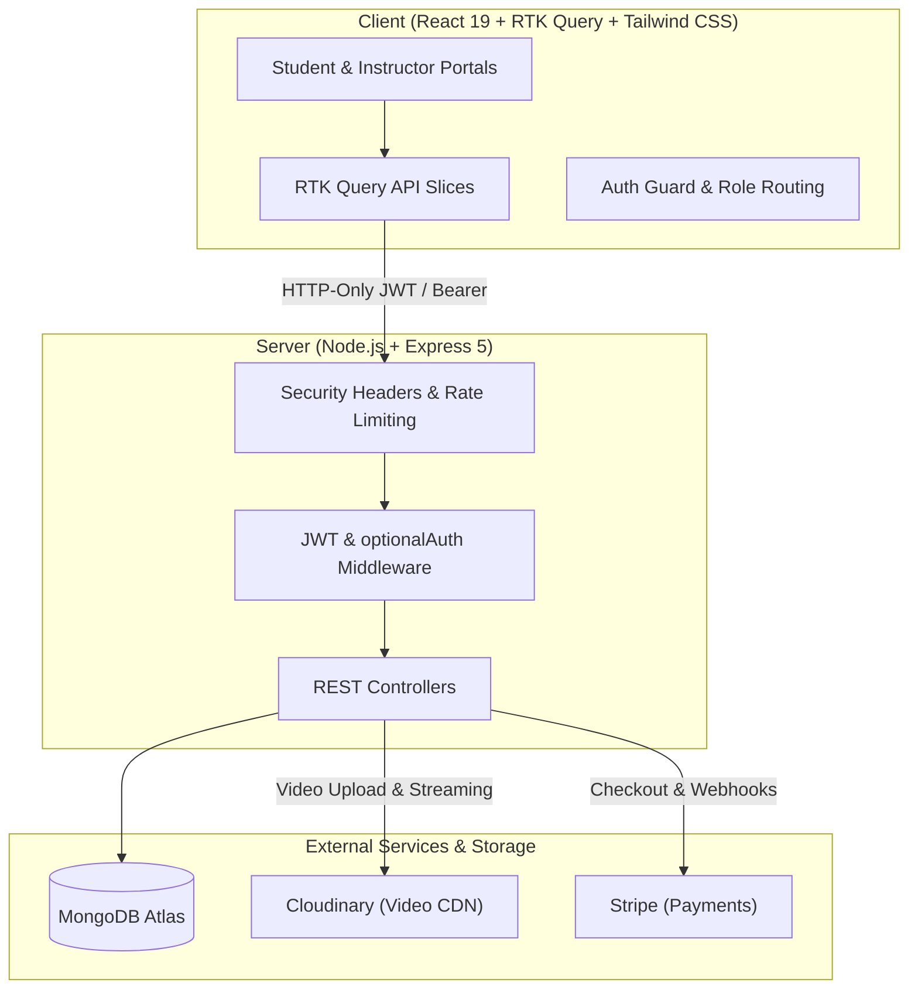
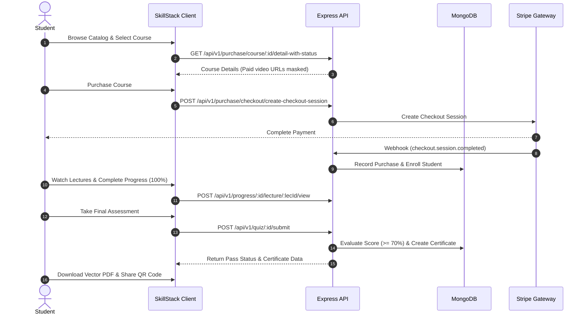
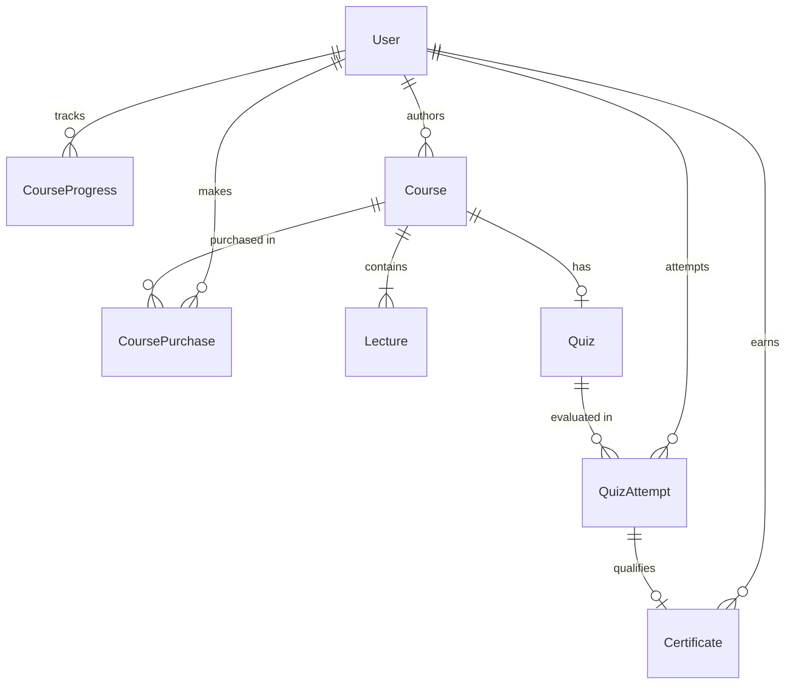

# 🎓 SkillStack LMS

<p align="center">
  <strong>A modern, enterprise-ready Learning Management System built with the MERN stack.</strong>
</p>

<p align="center">
  <a href="https://github.com/SandeepCodes31/SkillStack/stargazers"></a>
  <a href="https://react.dev/"></a>
  <a href="https://nodejs.org/"></a>
  <a href="https://expressjs.com/"></a>
  <a href="https://www.mongodb.com/"></a>
  <a href="https://tailwindcss.com/"></a>
  <a href="https://stripe.com/"></a>
  <a href="https://cloudinary.com/"></a>
  <a href="#-automated-testing"></a>
  <a href="https://opensource.org/licenses/ISC"></a>
</p>

---

## 📖 Overview

**SkillStack LMS** is a full-stack educational platform designed for modern online learning. It connects students with high-quality tech courses while providing instructors with powerful course authoring, curriculum building, and analytics tools.

The platform handles end-to-end learning workflows: open course discovery, secure checkout via Stripe, video classrooms with progress tracking, randomized end-of-course assessments, cryptographically verifiable PDF certificates with scannable QR codes, and gamified daily learning streaks.

---

## ⚡ Core Features

### 👨‍🎓 For Students
- **Open Course Discovery**: Fast search and multi-criteria filtering by category, difficulty level, and price without mandatory login barriers.
- **Interactive Syllabus & Free Previews**: Explore course curricula with duration badges and preview free lessons before purchasing.
- **Structured Video Classroom**: Seamless video playback with automated lecture-by-lecture progress tracking and completion synchronization.
- **End-of-Course Quizzes**: Timed multiple-choice assessments unlocked after completing 100% of curriculum lectures.
- **Verifiable PDF Certificates**: Automatically issued upon passing course quizzes, featuring embedded QR codes for public verification.
- **Learning Streaks & Activity Tracker**: Daily streak counters, weekly activity trackers, and milestone badges to encourage consistency.
- **Payment Invoices**: Instant access to detailed financial receipts and downloadable PDF invoices.

### 👨‍🏫 For Instructors & Admins
- **Role-Based Workflows**: Dedicated dashboards for course creators and platform administrators.
- **Course & Curriculum Builder**: Multi-step course editor with rich-text descriptions, Cloudinary thumbnail uploads, and draft/publish toggles.
- **Lecture Management**: Direct video upload pipeline with Cloudinary transcoding and free-preview configuration.
- **Quiz Creator**: Attach timed, randomized multiple-choice assessments with custom passing score thresholds.
- **Revenue & Enrollment Analytics**: Visual metric cards for revenue, active students, and course sales.

### 🛡️ Security & Integrity
- **Password Protection**: Passwords salted and hashed with `bcryptjs` (never stored in plaintext).
- **Stateless JWT with Server Revocation**: Tokens delivered via HTTP-Only cookies with `tokenVersion` tracking to instantly invalidate logged-out sessions.
- **Role Escalation Defense**: Restricts administrative roles to authorized administrator emails during registration.
- **Video Asset Protection**: Paid lecture video URLs are sanitized to `null` server-side for non-enrolled students.
- **API Hardening**: In-place NoSQL injection protection, rate limiting on auth and upload routes, CSRF guards, and secure HTTP headers (`nosniff`, `frameguard`).

---

## 🛠️ Tech Stack

| Layer | Technologies |
| :--- | :--- |
| **Frontend** | React 19, Vite, Tailwind CSS v4, React Router v7, Radix UI Primitives, Lucide Icons, Jodit Editor |
| **State Management** | Redux Toolkit, RTK Query (normalized caching, optimistic updates, tag invalidation) |
| **Backend** | Node.js (v20+), Express 5, RESTful API architecture |
| **Database** | MongoDB Atlas, Mongoose 9 (strict schemas, compound indexes, model relationships) |
| **Media & CDN** | Cloudinary (adaptive video streaming, thumbnail optimization), Multer |
| **Payments** | Stripe Checkout, Raw-Buffer HMAC Webhook verification |
| **Documents & QR** | PDFKit (server-side vector PDF generation), QRCode (cryptographic verification links) |
| **Security** | JWT (`jsonwebtoken`), Bcrypt.js, Express Rate Limit, Helmet-style security headers |
| **Tooling & QA** | ESLint 9 (0 errors), Native Node Test Suite (41 automated tests) |

---

## 🏗️ Architecture & Workflows

### System Architecture



### Student Learning & Certificate Lifecycle



### Database Entity Relationships



---

## 📂 Project Structure

```text
SkillStack/
├── client/                           # Frontend React Application
│   ├── public/images/courses/        # 24 local high-res course thumbnail assets
│   ├── src/
│   │   ├── app/                      # Redux store and root reducer
│   │   ├── components/               # UI components, layout, navbar, modals
│   │   ├── config/api.config.js      # Centralized environment API configuration
│   │   ├── features/api/             # RTK Query API slices (auth, course, quiz...)
│   │   ├── pages/
│   │   │   ├── admin/                # Course, lecture, and quiz management
│   │   │   └── student/              # Catalog, classroom, dashboard, certificates
│   │   ├── App.jsx                   # Application routing
│   │   └── main.jsx                  # React DOM entry point
│   ├── eslint.config.js              # ESLint configuration
│   └── vite.config.js                # Vite build config
│
├── server/                           # Backend Express API
│   ├── controllers/                  # Route controller logic
│   ├── database/db.js                # MongoDB connection handler
│   ├── middlewares/                  # Auth, rate limiting, and security guards
│   ├── models/                       # Mongoose schemas (User, Course, Quiz...)
│   ├── routes/                       # Express route modules
│   ├── scripts/                      # Seeders and automated test suites
│   │   ├── seedCourses.js            # 24-course & 192-lecture realistic seeder
│   │   ├── validateSeedData.js       # Catalog quality validator (23 tests)
│   │   ├── testAuthAndRoles.js       # Auth & role isolation test suite (9 tests)
│   │   └── testFullLifecycle.js      # Student lifecycle & E2E suite (9 tests)
│   ├── utils/                        # Cloudinary, PDFKit, and Multer helpers
│   └── index.js                      # Express application entry
│
├── package.json                      # Unified root scripts (dev, build, test, lint)
└── README.md
```

---

## 🧪 Automated Testing

SkillStack features an automated test suite executed against live MongoDB models and Express endpoints on ephemeral test ports.

```bash
# Run all 41 automated tests
npm test
```

### Test Suite Coverage

```text
=================================================
🧪 SkillStack LMS - Data Quality & API Validation (23 Tests)
=================================================
  ✓ PASS: Category distribution (>= 3 courses in all 6 categories)
  ✓ PASS: Publication status (30 published, 4 drafts for isolation)
  ✓ PASS: Difficulty levels (Beginner, Intermediate, Advanced)
  ✓ PASS: Pricing integrity (Free & paid pricing tiers, no negative values)
  ✓ PASS: Instructor references & user role validation
  ✓ PASS: Curriculum & lecture linkage (192 lectures verified)
  ✓ PASS: 24 local high-resolution thumbnail assets on disk (> 1KB)
  ✓ PASS: Course search & text indexing simulation
  ✓ PASS: Draft isolation (Unpublished courses excluded from public queries)

================================================================================
🚀 Automated Auth, Role & Isolation Suite (9 Tests)
================================================================================
  ✓ PASS: Password hashing & bcrypt verification ($2 salt prefix)
  ✓ PASS: Role escalation prevention during registration (HTTP 403)
  ✓ PASS: Authentication & JWT token issuance (HTTP 200)
  ✓ PASS: Invalid credential rejection (HTTP 400)
  ✓ PASS: Student blocked from instructor / creator routes (HTTP 403)
  ✓ PASS: Admin authorized on creator routes (HTTP 201)
  ✓ PASS: Server-side session invalidation (tokenVersion increment on logout)
  ✓ PASS: Cross-user data isolation (Student A blocked from Student B's receipt)
  ✓ PASS: HTTP security headers (nosniff, frameguard DENY)

================================================================================
🚀 Automated Full Student Lifecycle & Integration Suite (9 Tests)
================================================================================
  ✓ PASS: Public course discovery & search (Guest access without token)
  ✓ PASS: Course details & paid video URL masking (Sanitized to null)
  ✓ PASS: Student session authentication & cookie verification
  ✓ PASS: Course enrollment & purchase status update (purchased: true)
  ✓ PASS: Lecture progress tracking & completion percentage calculation
  ✓ PASS: Assessment execution, anti-cheat, & server-side evaluation (100% score)
  ✓ PASS: Automatic certificate issuance & public QR verification (No auth required)
  ✓ PASS: Financial receipt generation & ownership verification
  ✓ PASS: Daily learning streak & activity calendar recording
```

---

## 🚀 Quick Start Guide

### Prerequisites
- **Node.js** (v20.0.0 or higher)
- **npm** (v10.0.0 or higher)
- **MongoDB** Atlas URI or local instance
- **Cloudinary** account
- **Stripe** developer account

### 1. Clone & Install
```bash
git clone https://github.com/SandeepCodes31/SkillStack.git
cd SkillStack

# Install all dependencies (root, client, server)
npm install
npm install --prefix client
npm install --prefix server
```

### 2. Environment Setup

Create `server/.env`:
```env
PORT=8080
NODE_ENV=development
MONGO_URI=your_mongodb_connection_string
SECRET_KEY=your_jwt_secret_key_minimum_32_characters
CLOUD_NAME=your_cloudinary_cloud_name
API_KEY=your_cloudinary_api_key
API_SECRET=your_cloudinary_api_secret
STRIPE_SECRET_KEY=your_stripe_secret_key
STRIPE_PUBLISHABLE_KEY=your_stripe_publishable_key
WEBHOOK_ENDPOINT_SECRET=your_stripe_webhook_secret
FRONTEND_URL=http://localhost:5173
```

Create `client/.env`:
```env
VITE_API_BASE_URL=http://localhost:8080
```

### 3. Populate Sample Course Dataset
```bash
npm run seed:courses
```
*Seeds 24 realistic courses, 192 lectures across 6 tech domains, and verified instructors.*

### 4. Run Tests & Lint
```bash
npm test       # Run 41 automated tests
npm run lint   # Run ESLint (0 errors)
```

### 5. Start Development
```bash
# Terminal 1: Backend API (Port 8080)
npm run server

# Terminal 2: Frontend Client (Port 5173)
npm run client
```

---

## 📡 REST API Summary

| Module | Method | Endpoint | Description | Access |
| :--- | :--- | :--- | :--- | :--- |
| **Auth** | `POST` | `/api/v1/user/register` | Register student account | Public |
| | `POST` | `/api/v1/user/login` | Authenticate & issue JWT cookie | Public |
| | `GET` | `/api/v1/user/logout` | Revoke session & increment tokenVersion | Authenticated |
| | `GET` | `/api/v1/user/profile` | Get current user profile & enrollments | Authenticated |
| **Courses**| `GET` | `/api/v1/course/search` | Search & filter published courses | Public (`optionalAuth`) |
| | `GET` | `/api/v1/course/published-courses` | Get published courses list | Public |
| | `POST` | `/api/v1/course` | Create course draft | Instructor / Admin |
| | `PUT` | `/api/v1/course/:id` | Update course details & thumbnail | Instructor / Admin |
| | `PATCH`| `/api/v1/course/:id` | Toggle published / draft status | Instructor / Admin |
| | `POST` | `/api/v1/course/:id/lecture` | Create lecture & attach video | Instructor / Admin |
| **Payments**| `POST` | `/api/v1/purchase/checkout/create-checkout-session` | Initialize Stripe checkout | Student |
| | `POST` | `/api/v1/purchase/webhook` | Stripe HMAC signed webhook | Stripe |
| | `GET` | `/api/v1/purchase/course/:id/detail-with-status` | Get course with purchase status | Public (`optionalAuth`) |
| | `GET` | `/api/v1/purchase/receipt/:id` | Fetch verified payment receipt | Owner / Admin |
| **Progress**| `GET` | `/api/v1/progress/:courseId` | Get lecture completion progress | Student |
| | `POST` | `/api/v1/progress/:courseId/lecture/:lectureId/view` | Mark lecture as watched | Student |
| **Quizzes** | `GET` | `/api/v1/quiz/course/:courseId` | Get quiz info & eligibility | Student |
| | `POST` | `/api/v1/quiz/:quizId/start` | Start timed attempt | Student |
| | `POST` | `/api/v1/quiz/:quizId/submit` | Submit answers & grade assessment | Student |
| **Certificates**| `GET`| `/api/v1/certificate/verify/:identifier` | Public QR certificate verifier | Public |
| | `GET` | `/api/v1/certificate/:id/pdf` | Stream downloadable PDF certificate | Student |
| **Streaks** | `GET` | `/api/v1/streak/my` | Get current streak & weekly tracker | Student |
| | `GET` | `/api/v1/streak/badges` | Get milestone badge achievements | Student |

---

## 👨‍💻 Author

**Sandeep Pal**
- GitHub: [@SandeepCodes31](https://github.com/SandeepCodes31)
- Repository: [SkillStack LMS](https://github.com/SandeepCodes31/SkillStack)

---

## 📄 License

This project is licensed under the [ISC License](LICENSE).
